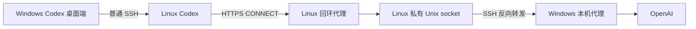

# Codex SSH Proxy
主要实现远程Linux服务器,通过走Windows的HTTP代理而非服务器原有网络,去访问OPENAI相关模型服务等,服务器上其他网络请求仍走正常网络.
在 Windows 上启动 SSH 反向转发，让远端 Linux 的 Codex CLI 和 `app-server` 使用 Windows 已有的 HTTP 代理。代码也支持 Windows Codex 桌面端的 Remote SSH。项目文件、命令和普通 shell 流量都留在 Linux 的正常运行环境中。 [Codex Remote SSH](https://learn.chatgpt.com/docs/remote-connections#connect-to-an-ssh-host)

## 准备

- Windows 有 Python 3.8+、系统 OpenSSH 客户端，以及监听在 `127.0.0.1` 的 HTTP 或混合代理。该代理需要支持 HTTPS `CONNECT`。
- Windows 的 `~/.ssh/config` 配置好一个 Linux 主机别名，可使用公钥非交互连接，服务器主机密钥已核验。Linux SSH 服务需要允许 Unix socket 反向转发。
- Linux 有 Python 3.6+、`curl` 和 Codex CLI。脚本中的 `CODEX` 默认指向 `~/.local/bin/codex`。使用 Remote SSH 时，桌面端调用的 Linux 登录 shell 也要能通过 `PATH` 找到 Codex。

## 启动

将下面的 `codex-linux` 换成你的 SSH 别名，将 `7890` 换成 Windows 代理软件的 HTTP 或混合代理端口。在仓库目录打开 PowerShell，先验证 SSH 和转发。

```powershell
ssh -nT -o BatchMode=yes -o ConnectTimeout=8 codex-linux hostname
python .\start.py verify --host codex-linux --windows-proxy-port 7890
```

首次授权时用 `login` 模式，让远端 CLI 请求设备码，然后在 Windows 浏览器完成授权。已有登录时可以直接启动 `desktop` 或 `run`。 [Codex 设备码登录](https://learn.chatgpt.com/docs/auth#login-on-headless-devices)

```powershell
python .\start.py login --host codex-linux --windows-proxy-port 7890
python .\start.py desktop --host codex-linux --windows-proxy-port 7890
```

看到 `Desktop proxy ready` 后，在 Windows Codex 的 **设置 → 连接 → SSH** 启用该主机，然后添加 Linux 项目目录。保持 Windows 代理和启动窗口在线。结束时按 `Ctrl+C` 并等 PowerShell 提示符回来。

如果直接使用远端交互式 CLI，用 `run` 并指定 Linux 项目目录。

```powershell
python .\start.py run --host codex-linux --windows-proxy-port 7890 --project '~/my-project'
```

`smoke` 模式会发起一次只读模型请求来验证工作目录和 shell 环境，会使用账号额度。`Start-CodexProxy.ps1` 是可选包装器，支持 `-Mode`、`-HostAlias`、`-WindowsProxyPort`、`-Project` 和 `-Python`。

## 网络如何接通



1. `start.py` 在 Linux 上通过 SSH 创建私有临时目录，用 `ssh -R` 将目录中的 Unix socket 接到 Windows 的 `127.0.0.1:<代理端口>`，并通过 SSH 启动 `proxy.py`。 [OpenSSH 反向转发](https://man.openbsd.org/ssh.1#R)
2. `proxy.py` 在 Linux 回环地址提供 HTTP 代理，桌面模式使用固定端口 `47890`，其他模式使用临时端口。它校验代理认证，只允许向 `auth.openai.com`、`chatgpt.com` 和 `api.openai.com` 的 `443` 端口建立 `CONNECT` 隧道。
3. CLI 模式只向 Codex 进程传递代理变量。桌面模式暂时写入远端 `$CODEX_HOME/.env`，并在 Codex 配置中设置子进程环境过滤。`CODEX_HOME` 默认为 `~/.codex`。正常退出时清理临时 `.env` 和 SSH 转发目录。登录缓存、子进程过滤和桌面代理认证值留在该 Linux 账号的 Codex 目录。 [Codex 子进程环境配置](https://learn.chatgpt.com/docs/config-file/config-advanced#shell-environment-policy)

Windows 代理软件按它自己的节点和分流规则出网。换节点且代理端口相同时，SSH 转发仍指向同一个 Windows 入口。换 HTTP 代理端口时，用新的 `--windows-proxy-port` 重新启动隧道即可。

## 常见问题

| 现象 | 检查方法 |
| --- | --- |
| `[1/3]` 阶段超时 | 用 `ssh -v -nT -o BatchMode=yes -o ConnectTimeout=8 codex-linux hostname` 检查 SSH 连接、认证和远程命令。 |
| `[2/3]` 阶段转发失败 | 检查服务器是否允许 Unix socket 反向转发。 |
| 代理端点不通 | 用 `verify` 检查 Windows 的代理监听端口。模型端点的 `200/401` 表示代理连接成立，站点收到了测试请求。 |
| CLI 已登录，桌面提示未登录 | 桌面端可能复用了登录或代理开启前的服务。确认服务空闲后，可在 Linux 上用 `codex app-server daemon restart` 重启，再重连桌面端。 |
| `.env` 或 shell 环境策略冲突 | 保留并检查原配置，再合并所需的代理变量或子进程过滤。脚本发现冲突时会退出。 |

多人共用同一个 Linux 账号时，他们共享该账号的文件权限。需要隔离登录凭据时，使用独立 Linux 账号。发布或分享项目时，保留真实 SSH 配置、私钥和账号凭据在本机。
